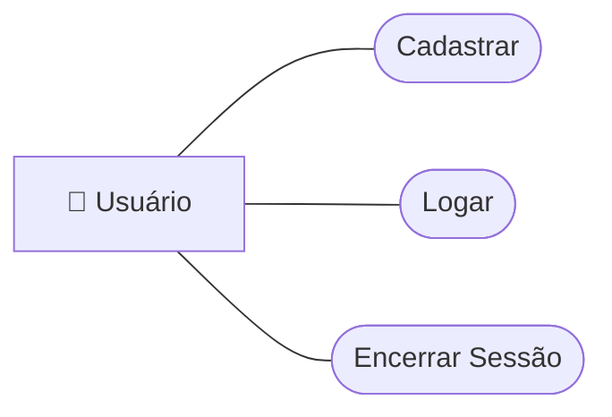
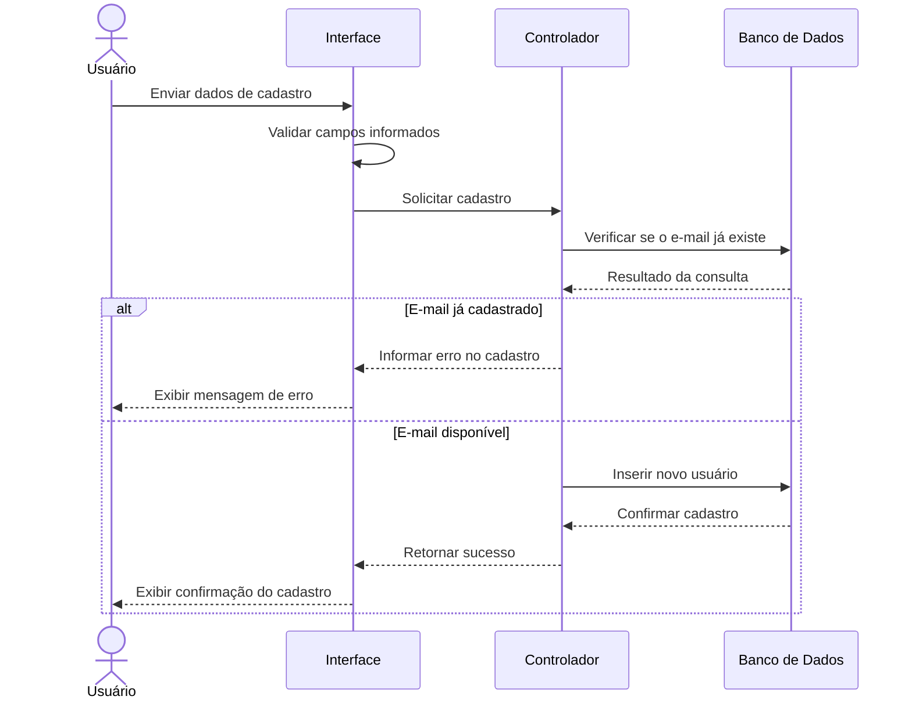
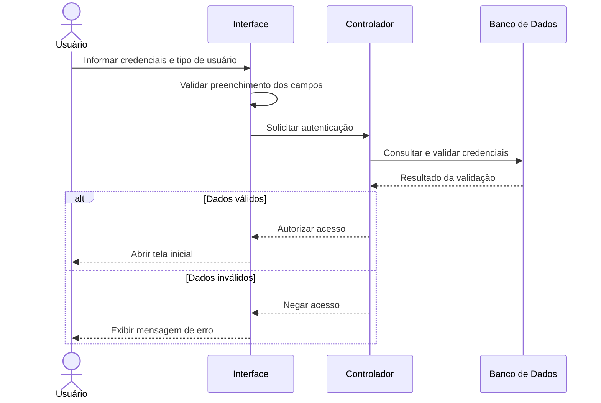
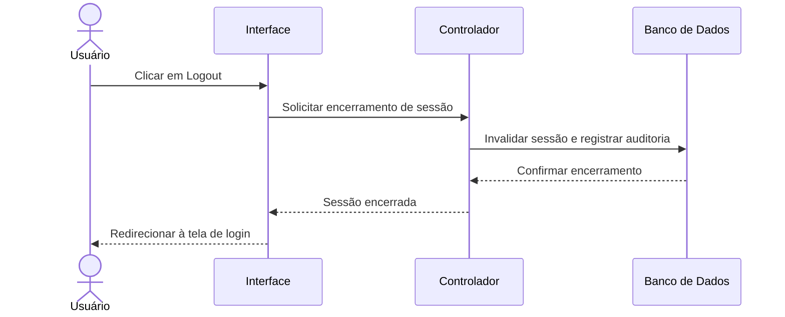
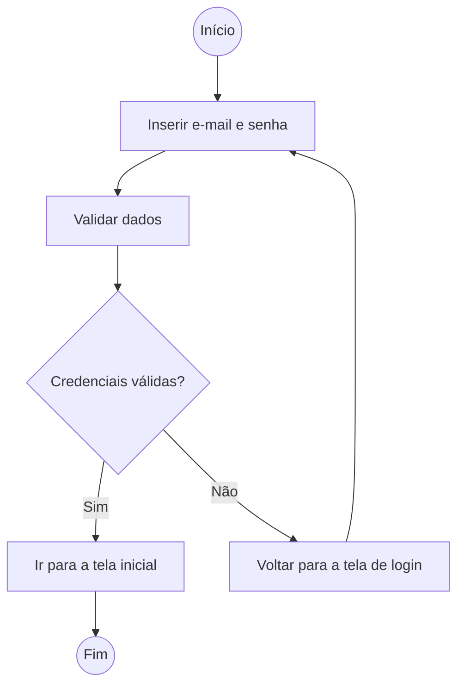

# Personal App
Universidade Federal do Amazonas (UFAM) |
Instituto de Ciências Exatas e Tecnologia (ICET) |
Curso: Engenharia de Software |
Local: Itacoatiara/AM |
Ano: 2026

Integrantes da equipe:
- Davi Marques
- Sérgio Roberto
- Brendo de Castro

## 1. Introdução
### 1.1. Descrição Geral do Software
O Personal App é um aplicativo de agendamento e pagamento de serviços de personal trainer destinado aos alunos de uma academia. Por meio da aplicação, os alunos podem encontrar profissionais, consultar horários disponíveis, agendar treinos e buscar opções que se ajustem ao seu orçamento.

Além do agendamento, o documento do projeto prevê recursos relacionados a cadastro, autenticação, escolha de perfil, filtros de busca, métodos de pagamento e gerenciamento de sessões. Para os profissionais, a aplicação contempla a consulta da agenda e o registro de atendimentos.

Objetivo: facilitar o contato entre alunos e personal trainers, tornando a contratação e a organização dos treinos mais práticas.
### 1.2. Descrição dos Usuários
|Tipo de usuário|	Descrição|	Principal interesse|
|---|---|---|
|Aluno|	Pessoa que frequenta a academia para realizar exercícios físicos.|	Encontrar personal trainers, consultar horários, agendar e pagar pelos treinos.|
|Personal Trainer|	Profissional de Educação Física que planeja e acompanha treinos de acordo com as características individuais dos alunos.|	Organizar a agenda e registrar atendimentos.|
|Desenvolvedor|	Responsável pela manutenção e pelo funcionamento adequado da aplicação.|Gerenciar, desenvolver e testar o sistema.|

## 2. Requisitos Gerais do Software
Para identificar os requisitos, são utilizadas as siglas: RF (Requisito Funcional), RNF (Requisito Não Funcional), RN (Regra de Negócio).
### 2.1. Requisitos Funcionais

| Identificador | Descrição | Escopo | Prioridade |
|---|---|---|---|
| RF01 | Cadastrar aluno. |	Funcional |	Alta|
|RF02|	Agendar horário.|	Funcional|	Alta|
|RF03|	Consultar agenda do personal trainer.|	Funcional|	Alta|
|RF04|	Cancelar treinos.|	Funcional|	Média|
|RF05|	Registrar atendimento.|	Funcional|	Alta|
### 2.2. Requisitos Não Funcionais
|Identificador|	Descrição|	Categoria|	Escopo|	Prioridade|
|---|---|---|---|---|
|RNF01|	Exigir login e senha.|	Segurança|	Acesso ao sistema|	Alta|
|RNF02|	Apresentar informações em até 3 segundos.|	Desempenho|	Sistema	|Média|
|RNF03|	Manter o sistema disponível durante o funcionamento da academia.|	|Disponibilidade|	|Sistema|	|Alta|
|RNF04|	Possuir interface simples e fácil de utilizar.|	Usabilidade|	Usuários|	Média|
|RNF05|	Proteger os dados dos alunos.|	Segurança/Privacidade|	Dados dos alunos|	Alta|
### 2.3. Regras de Negócio
|Identificador|	Descrição|	Escopo|	Prioridade|
|---|---|---|---|
|RN01|	Não permitir dois alunos para o mesmo personal trainer no mesmo horário.|	Agendamento|	Alta|
|RN02|	O aluno deve estar cadastrado antes de realizar um agendamento.|	Cadastro|	Alta|
|RN03|	O treino deve ser cancelado antes do horário marcado.|	Agendamento|	Média|
|RN04|	Somente usuários autorizados podem acessar dados dos alunos.|	Segurança|	Alta|
|RN05|	O personal trainer deve registrar o atendimento após o treino.|	Atendimento|	Alta|

## 3. Diagramas UML
Os diagramas a seguir representam os três casos de uso apresentados no documento original: Cadastrar, Logar e Encerrar Sessão. Os códigos Mermaid permitem visualizar os fluxos diretamente no README do GitHub.
3.1. Diagramas de Casos de Uso
Visão dos casos de uso

Especificação — UC1: Cadastrar
Campo	Descrição
Caso de uso	UC1 — Cadastrar
Ator principal	Usuário
Atores secundários	Não se aplica
Resumo	Criação do cadastro do usuário para acesso à aplicação.
Pré-condições	Ter acesso à internet e informar os dados corretamente.
Pós-condições	Se os dados forem válidos, o usuário será direcionado à tela de login.
Validação	Se os dados não forem válidos, o cadastro não será efetivado.

Fluxo principal: o usuário seleciona a opção de cadastro, informa e-mail, senha e categoria, e o sistema valida os dados e confirma a criação do cadastro.
Especificação — UC2: Logar
Campo	Descrição
Caso de uso	UC2 — Logar
Ator principal	Usuário
Atores secundários	Não se aplica
Resumo	Acesso à aplicação por meio de login.
Pré-condições	Ter acesso à internet, estar cadastrado e informar os dados corretamente.
Pós-condições	Se os dados forem válidos, o usuário será direcionado à tela inicial (home).
Validação	Se os dados não forem válidos, o login não será efetivado.

Fluxo principal: o usuário informa e-mail, senha e tipo de usuário, clica em Login e o sistema valida as informações, autentica o usuário e libera o acesso à aplicação.
Especificação — UC3: Encerrar Sessão
Campo	Descrição
Caso de uso	UC3 — Encerrar Sessão
Ator principal	Usuário
Atores secundários	Não se aplica
Resumo	Encerramento do acesso à aplicação.
Pré-condições	O usuário deve estar conectado à internet e autenticado no sistema.
Pós-condições	O documento original informa “não se aplica”; o fluxo prevê retorno à tela de login.
Validação	Não se aplica.

Fluxo principal: o usuário clica em Logout, o sistema encerra a sessão e redireciona o usuário à tela de login.
### 3.2. Diagramas de Sequência
Os diagramas de sequência representam a comunicação entre o Usuário, a Interface, o Controlador e o Banco de Dados nos principais fluxos de acesso à aplicação.
Sequência — Cadastrar

Sequência — Logar

Sequência — Encerrar Sessão (Logout)

### 3.3. Diagramas de Atividades
O diagrama de atividades do documento apresenta o processo de login, desde o preenchimento dos campos até a verificação das credenciais.
Atividade — Realizar Login

